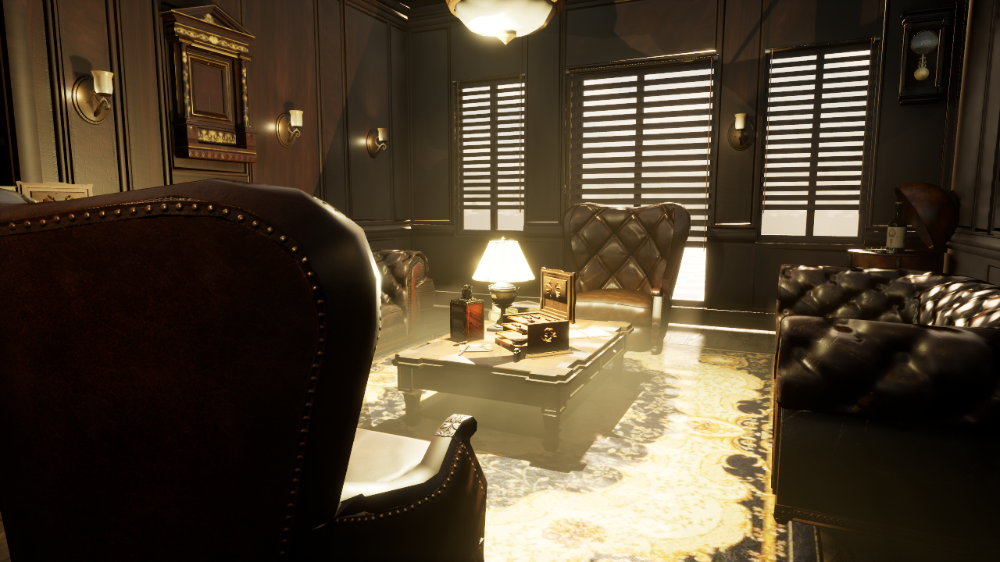

# Week 10: profiling and optimization

## Start here

[Download the complete teaching kit](https://github.com/anthonymonteagudo/Week10-Profiling/releases/download/week10-teaching-materials-v2/Week10-Teaching-Kit.zip), extract it, and open **START-HERE.html**. It includes the deck with notes, printable handouts, visual guides and course tools. UE/Fab content and comparison projects are separate downloads listed below.

To keep a Git checkout: `git clone https://github.com/anthonymonteagudo/Week10-Profiling.git`, then `git pull --ff-only` for updates. The generated HTML pages open locally without installing Node or Python. Python is needed only for the optional Python tools.

1. [Set up the UE 5.7 furnished lounge lab](Unreal/README.md). The [starter ZIP](https://github.com/anthonymonteagudo/Week10-Profiling/releases/tag/week10-ue57-optimization-lab-v4) contains our project tools and setup; obtain the free Fab environment separately.
2. Follow the [student lab and evidence worksheet](Student-Lab.md).
3. Use the [single Week 10 slide deck](Week10-Slides.pptx) and [optimization study guide](Optimization-Study-Guide.md).

The lab opens Lounge_Unoptimized, a furnished interior with deliberately introduced production mistakes. Keep its reference map unchanged and test one reversible change. The content-only editor plugin adds **Tools > Week 10 Optimization** for a custom viewport overlay and a searchable local dashboard. Disable the overlay before timing. Findings are candidates rather than proven savings.

## Supporting tools and demonstrations

- [Capture comparison](Tools/compare_captures.py) and [frame-budget report](Tools/report_perf_budget.py) process Unreal CSVs. Run `python Tools/compare_captures.py --help` for options.
- [Read-only inventory](Tools/audit_optimization_candidates.py) is an optional simple Python rule example; the lab plugin is the main audit workflow.
- [Texture mask packer](Tools/pack_masks.py) and [practice inputs](Tools/DemoInputs) require Python and Pillow. Run `python Tools/pack_masks.py Tools/DemoInputs/AO.png Tools/DemoInputs/Roughness.png Tools/DemoInputs/Metallic.png Packed_ORM.png`.
- [Material, debris and Niagara comparison projects](https://github.com/anthonymonteagudo/Week10-Profiling/releases/tag/week10-ue57-comparison-demos-v2): UE 5.7 Windows editor binaries and C++ source are supplied. Rebuild with the Windows C++ toolchain if your engine build does not match. These are separate instructor-led demonstrations.
- [Editable texture demo release](https://github.com/anthonymonteagudo/Week10-Profiling/releases/tag/week10-ue57-texture-demos-v1) opens ArrayDemo and is separate from the optimization lab.

Use the local dashboard generated from your own open map. The lecture's private hosted dashboard is a historical snapshot and is not a live view of your project. Instructor answer keys and the complete licensed classroom working copy are distributed separately.

## Material and shader logic

The deck now includes the shader-cost sequence at 91–110. The [study guide](Optimization-Study-Guide.md#material-and-shader-logic) supplies optimization decisions, graph recipes, two runnable experiments and a results worksheet. Use the updated comparison-project release for DynamicZero/MasterOff and UVPixel/UVVertex.

Browse the [material lab source and experiment instructions](MaterialCostLab/README.md). Generated material assets are supplied in the v2 comparison release.

The consolidated deck has 170 slides. Optional article/04 investigations cover first-use PSO hitches, Nanite/fallback/WPO checks, compile/cook budgets, trace counters and calibrated quality tiers. The main lounge activity is slide 134.

## Demo captures

[Open the 28-capture gallery](Media/Optimization-Demo/index.html) or [download the screenshot pack](https://github.com/anthonymonteagudo/Week10-Profiling/releases/tag/week10-demo-captures-v1). It covers the furnished room, Light Mixer, Timing Insights, stat unit/GPU, material buffers, Nanite, VSM cache, GPU resources and the custom audit. Each image includes its question, live steps and interpretation limits. The v4 lab explicitly uses DX12 SM6; earlier lounge timing results used SM5 fallback rendering.

The 28 captures are embedded directly in the deck. The main sequence runs through 148; the walkthrough guide is 149 and the complete numbered walkthroughs are 150–169. Materials/textures/shader logic occupy 75–116, and the custom audit appears before the break and lab.

The final slide (170) lists the source collections and features Tom Looman first. Open the [complete source index](Optimization-Study-Guide.md#complete-source-index) for all 86 article, video, documentation and media links, with relevant slide numbers.

Slide 7 introduces A/B testing; 150 supplies the detailed setup. Open the Notes pane for local definitions of rendering and measurement terms. The full measured sequences and thirty-minute lab at 134 are preserved.

## Visual definitions

Open the [optimization field guide](Media/Optimization-Field-Guide/index.html) for the Simon and Gnomon source figures, definitions, console/recovery reference and Unreal inspection tasks. New Gnomon visuals are at 53, 56, 60, 63, 80 and 93. The deck has 170 slides; break 133, lab 134, final sources 170.

Gnomon Parts 05–08 are assessed and integrated with source/context qualifications. Five duplicate showroom-reference slides are archived; the full twenty-step walkthrough and furnished-lounge activity remain. The visual theme now follows Week 9. UE/Fab projects remain separate linked downloads.

## Core teaching path

The canonical deck has **73 visible teaching slides and 97 hidden reference slides** (170 total). Use the normal slide show from slide 1; optional detail is preserved with native PowerPoint Hide Slide flags. Numbers remain stable: break 133, lounge lab 134, sources 170. The twenty walkthroughs (150–169) are available as hidden reference; choose a specific walkthrough only when needed.
